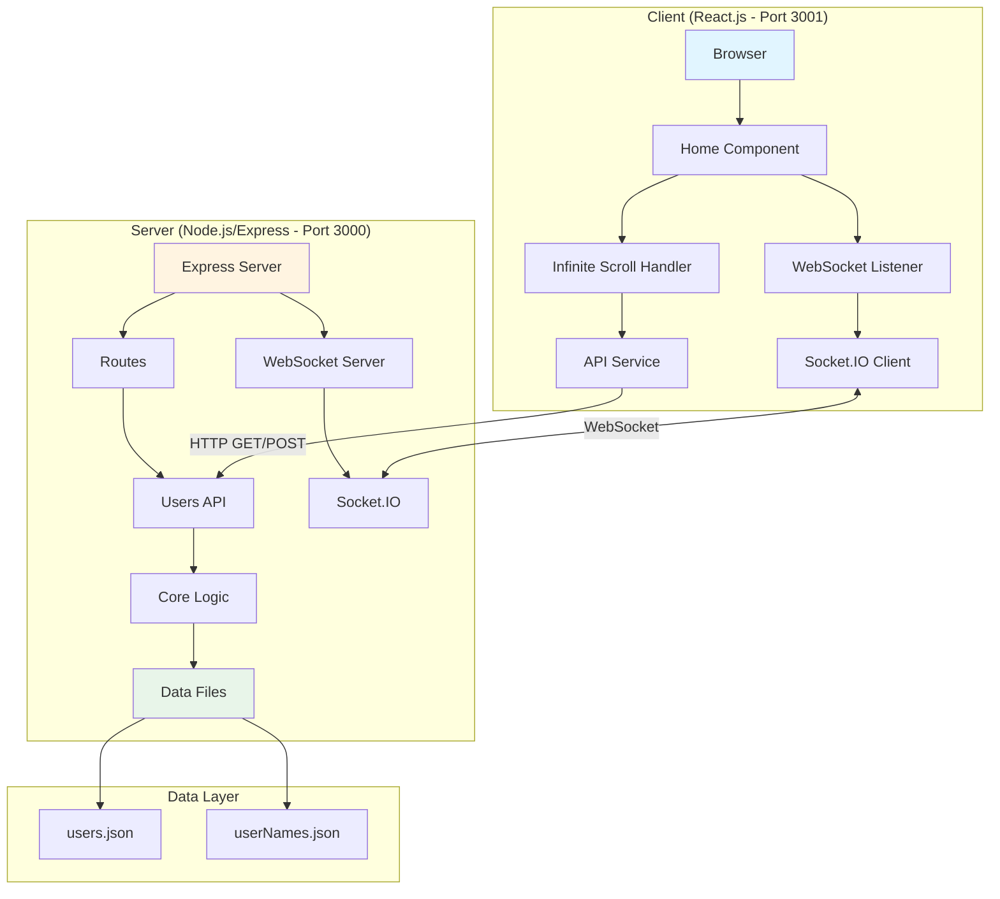
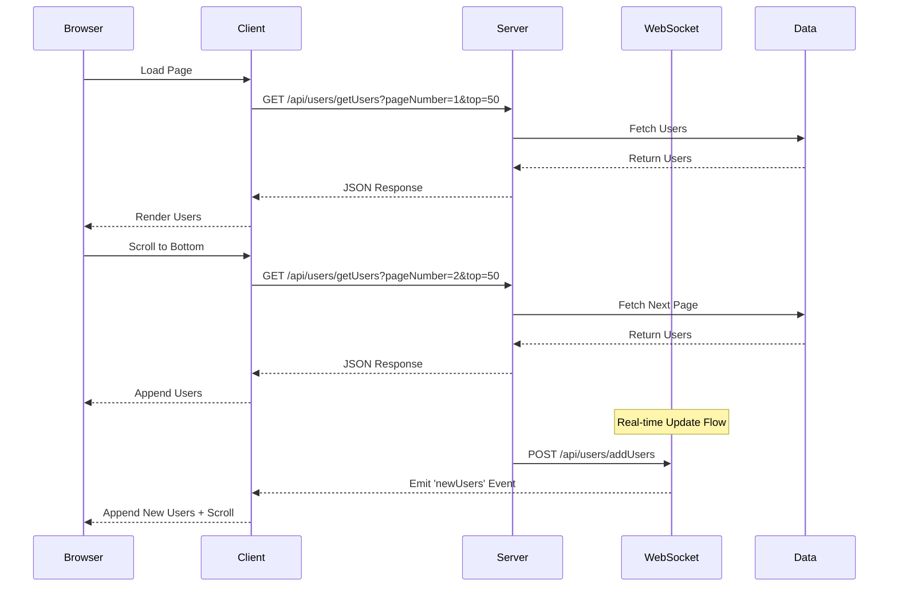

# Users List

A full-stack React.js + Node.js application demonstrating infinite scroll pagination with real-time WebSocket updates. Users are loaded dynamically as you scroll, and new users added via API are instantly pushed to all connected clients.

Built in November 2018. This project showcases modern web development patterns including RESTful API design, WebSocket integration, responsive UI, and efficient data pagination.

## Features

- 📜 Infinite scroll with smooth loading experience
- ⚡ Real-time updates via WebSocket (Socket.IO)
- 🔄 RESTful API with pagination support
- 💾 Server-side caching for improved performance
- 🎨 Responsive and modern UI design
- 📊 Dynamic user data management
- 🔌 WebSocket connection handling
- ⚠️ Comprehensive error handling and logging

## Architecture



## Data Flow



## Getting Started

### Prerequisites

- Node.js (v10 or higher)
- npm (v5 or higher)

### Installation

1. Clone the repository:
```bash
git clone https://github.com/orassayag/users-list.git
cd users-list
```

2. Install and start the server:
```bash
cd server
npm install
npm start
```

Server will run on `http://localhost:3000`

3. In a new terminal, install and start the client:
```bash
cd client
npm install
npm start
```

Client will run on `http://localhost:3001`

4. Open your browser to `http://localhost:3001`

## Project Structure

```
users-list/
├── server/                    # Backend (Node.js/Express)
│   ├── api/                  # API utilities
│   ├── config/               # Environment configurations
│   ├── core/                 # Business logic
│   ├── data/                 # JSON data files
│   │   ├── users.json        # Users database
│   │   └── userNames.json    # Additional user names
│   ├── middleware/           # Express middleware
│   ├── models/               # Data models
│   ├── routes/               # API routes
│   ├── startup/              # Server initialization
│   ├── utils/                # Utility functions
│   └── index.js              # Server entry point
│
├── client/                   # Frontend (React.js)
│   ├── config/               # Build configurations
│   ├── public/               # Static assets
│   ├── scripts/              # Build scripts
│   └── src/
│       ├── api/              # API client
│       ├── components/       # React components
│       │   └── UI/           # Reusable UI components
│       ├── containers/       # Page containers
│       │   ├── App/          # App container
│       │   └── Home/         # Home page (infinite scroll)
│       ├── hoc/              # Higher-order components
│       ├── settings/         # Client configuration
│       ├── utils/            # Utility functions
│       └── index.jsx         # Client entry point
│
└── misc/                     # Documentation
    └── documents/
        └── Instructions.txt  # Original setup instructions
```

## Available Scripts

### Server

```bash
cd server
npm start        # Start the server
npm test         # Run tests (if available)
```

### Client

```bash
cd client
npm start        # Start development server
npm build        # Create production build
npm test         # Run tests
```

## API Documentation

### GET /api/users/getUsers

Fetches paginated users list.

**Query Parameters:**
- `pageNumber` (number) - Page number to fetch
- `top` (number) - Number of items per page

**Example:**
```bash
curl "http://localhost:3000/api/users/getUsers?pageNumber=1&top=50"
```

**Response:**
```json
[
  {
    "id": 1,
    "name": "John Doe",
    "position": "Developer",
    "monthlySalary": "$5000"
  }
]
```

### POST /api/users/addUsers

Adds new users and broadcasts via WebSocket to all connected clients.

**Request Body:**
```json
[
  {
    "name": "Jane Smith",
    "position": "Designer",
    "monthlySalary": "$4500"
  }
]
```

**Example:**
```bash
curl -X POST http://localhost:3000/api/users/addUsers \
  -H "Content-Type: application/json" \
  -d '[{"name":"Jane Smith","position":"Designer","monthlySalary":"$4500"}]'
```

## WebSocket Events

### Server → Client

**Event:** `newUsers`
- Emitted when new users are added via POST API
- Payload: Array of user objects
- All connected clients receive this event in real-time

### Client → Server

**Event:** `connection`
- Established when client connects
- Automatic reconnection on disconnect

## Key Technologies

### Backend
- **Node.js** - JavaScript runtime
- **Express.js** - Web application framework
- **Socket.IO** - Real-time bidirectional communication
- **Winston** - Logging library
- **node-cache** - In-memory caching
- **CORS** - Cross-origin resource sharing

### Frontend
- **React.js** - UI library (v16.5.2)
- **React Router** - Client-side routing
- **Socket.IO Client** - WebSocket client
- **Axios** - HTTP client
- **LESS** - CSS preprocessor
- **Webpack** - Module bundler

## Features in Detail

### Infinite Scroll

The application implements intelligent infinite scroll:
- Loads 50 users initially
- Automatically loads next page when scrolling to bottom
- Smooth scrolling to newly loaded content
- Loading indicators for better UX
- Prevents multiple simultaneous loads
- "End of list" message when no more data

### Real-time Updates

WebSocket integration provides:
- Instant updates across all connected clients
- No page refresh needed
- Automatic reconnection handling
- Smooth UI updates with scroll positioning

### Caching

Server-side caching improves performance:
- Reduces redundant data processing
- Faster response times
- Configurable cache expiration

### Error Handling

Comprehensive error management:
- Server-side error logging with Winston
- Client-side error states and messages
- Validation for API requests
- Graceful degradation

## Development

The project uses:
- **JavaScript (ES6+)** with Babel transpilation
- **ESLint** for code quality
- **Webpack** for bundling
- **LESS** for styling

## Contributing

Contributions are welcome! Please read [CONTRIBUTING.md](CONTRIBUTING.md) for details on the code of conduct and the process for submitting pull requests.

See [INSTRUCTIONS.md](INSTRUCTIONS.md) for detailed setup and development instructions.

## Author

* **Or Assayag** - *Initial work* - [orassayag](https://github.com/orassayag)
* Or Assayag <orassayag@gmail.com>
* GitHub: https://github.com/orassayag
* StackOverflow: https://stackoverflow.com/users/4442606/or-assayag?tab=profile
* LinkedIn: https://linkedin.com/in/orassayag

## License

This application has an MIT license - see the [LICENSE](LICENSE) file for details.
